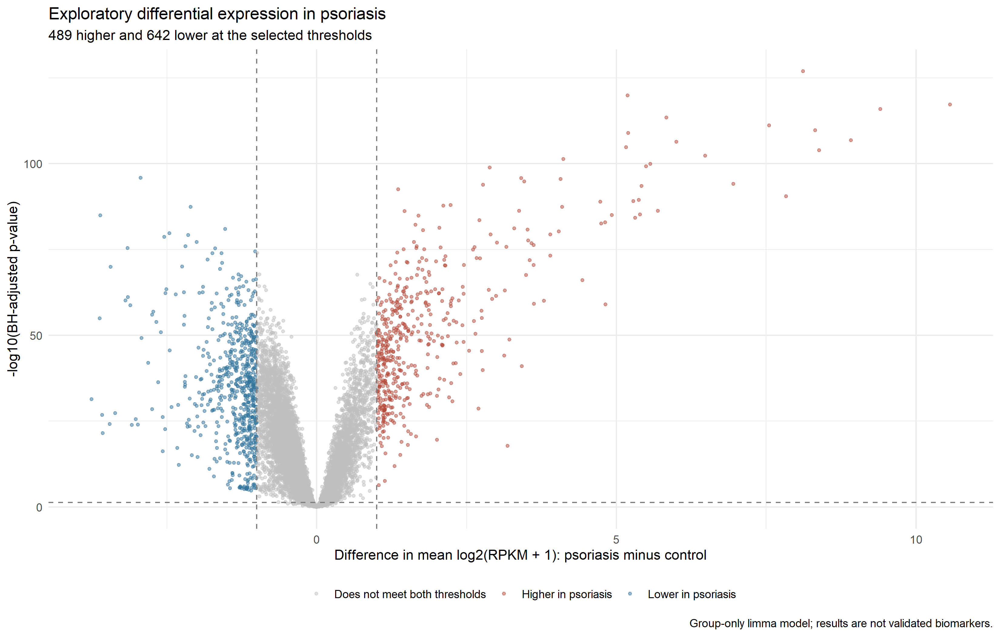
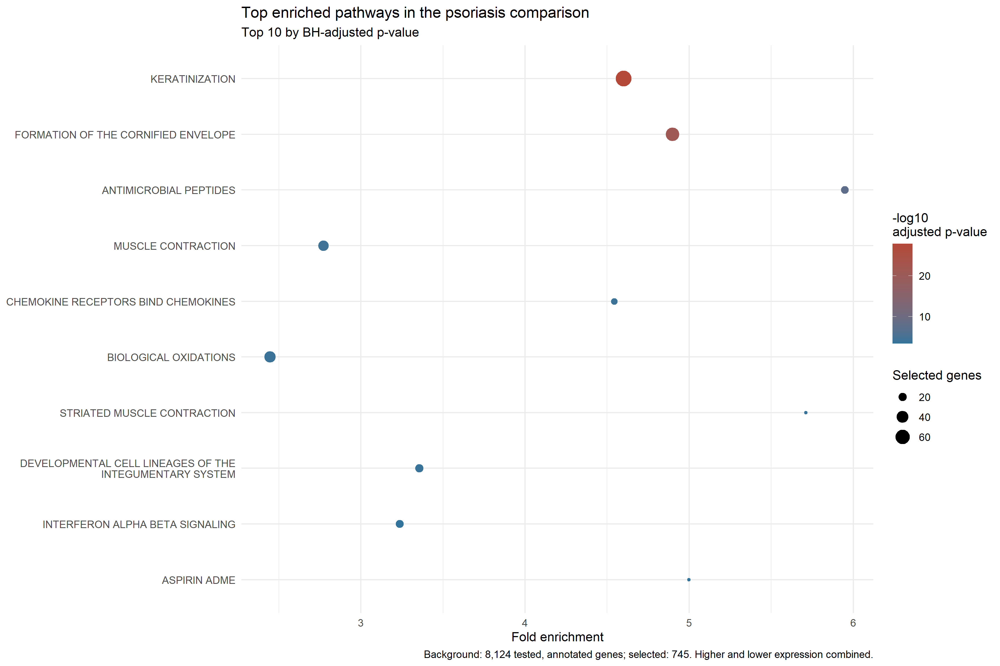
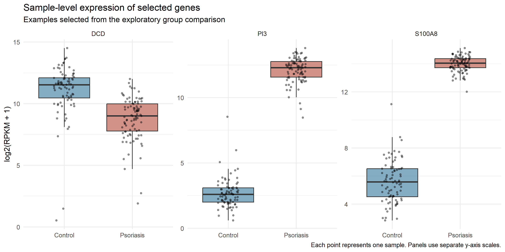
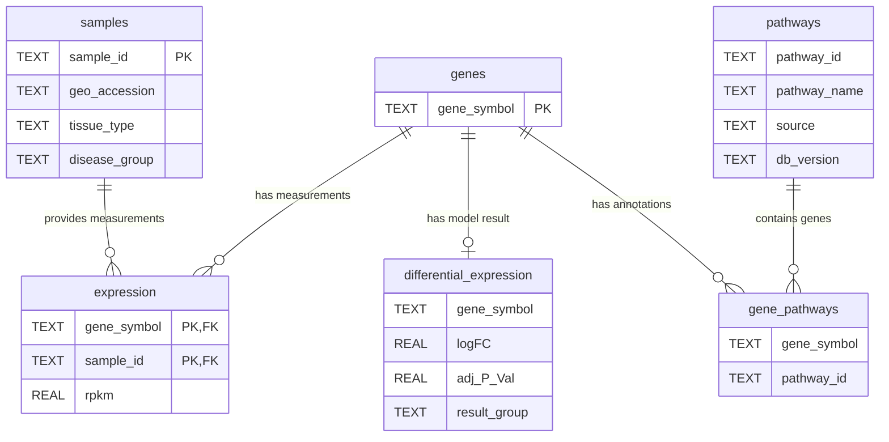

# Psoriasis Gene Expression and Pathway Analysis

An exploratory SQL and R analysis of public RNA-seq data comparing psoriasis-affected skin with healthy skin.

## Research Question

Which genes differ in expression between psoriasis-affected skin and healthy controls, and which biological pathways are overrepresented among the selected genes?

## Dataset

-   Source: NCBI Gene Expression Omnibus
-   Study: GSE54456
-   Link: https://www.ncbi.nlm.nih.gov/geo/query/acc.cgi?acc=GSE54456
-   Samples: 92 lesional psoriasis samples and 82 healthy controls
-   Input: processed RPKM expression values for 21,510 genes
-   Pathway annotations: MSigDB Reactome, version 2026.1.Hs

## Tools and Skills

-   SQLite: relational tables, primary and foreign keys, joins, conditional aggregation, and quality checks
-   R: data preparation, database access, statistical modeling, enrichment testing, and visualization
-   Packages: DBI, RSQLite, GEOquery, limma, msigdbr, and ggplot2

## Workflow

1.  Imported expression values and retrieved sample metadata.
2.  Matched sample identifiers and checked data quality.
3.  Built a SQLite database containing 3,742,740 expression records.
4.  Used SQL to calculate expression summaries by disease group.
5.  Filtered genes with low expression, retaining 14,865 genes.
6.  Fit a group-only limma model to log2(RPKM + 1) values.
7.  Selected genes with BH-adjusted p-value \< 0.05 and an absolute model coefficient of at least 1.
8.  Joined selected genes with Reactome pathway annotations.
9.  Tested pathway overrepresentation using hypergeometric tests with Benjamini–Hochberg adjustment.
10. Created figures in ggplot2.

## Key Results

-   489 genes had higher expression and 642 had lower expression under the exploratory selection criteria.
-   8,124 tested genes matched the pathway collection by exact gene symbol; 745 of these met the selection criteria.
-   45 pathways had an adjusted enrichment p-value below 0.05.
-   Leading pathways included keratinization, formation of the cornified envelope, and antimicrobial peptides.

| Pathway                             | Fold enrichment | Adjusted p-value |
|-------------------------------------|----------------:|-----------------:|
| Keratinization                      |            4.60 |         1.32e-28 |
| Formation of the cornified envelope |            4.90 |         5.06e-22 |
| Antimicrobial peptides              |            5.95 |         2.07e-08 |

## Visualizations

## Project Structure

-   R/: data preparation, analysis, and visualization scripts
-   sql/: quality checks and analysis queries
-   data/raw/: downloaded expression input
-   data/processed/: prepared data and generated SQLite database
-   results/tables/: exported analysis results
-   results/figures/: saved visualizations

## Running the Project

Open the RStudio project from the repository root.

Install the required CRAN and Bioconductor packages before running the scripts.

For an initial build, place the extracted GSE54456_RPKM_samples.txt file in data/raw/ and run:

1.  R/01_prepare_and_import_data.R
2.  R/02_run_expression_analysis.R
3.  R/04_differential_expression.R
4.  R/05_pathway_analysis.R
5.  R/03_visualize_results.R

If the database is already populated, skip script 01. Its import guard prevents duplicate insertion.

Internet access is required for downloading GEO metadata and MSigDB annotations.

## Limitations

-   This is an exploratory reanalysis of processed RPKM values.
-   The model includes disease group only; other biological or technical differences may influence the results.
-   The model coefficient measures a difference in mean log2(RPKM + 1), not the log ratio of arithmetic mean RPKM.
-   Pathway matching uses exact gene symbols. Some genes lack annotations or may use older identifiers.
-   Enrichment uses the 8,124 tested, annotated genes as background and includes pathways containing 10–500 background genes.
-   Higher- and lower-expression genes are combined for enrichment; results do not establish pathway activation or suppression.
-   Related pathways share genes and are not independent findings.
-   No independent validation or diagnostic performance testing was performed. These results do not establish validated biomarkers.

## Database Structure

Relationships show how the tables join. Foreign-key constraints are
enforced for the expression table; the model-result and pathway tables
were imported without database-level key constraints.

The diagram abbreviates the model-results table. Its adjusted p-value
column is named `adj.P.Val` in the database.
